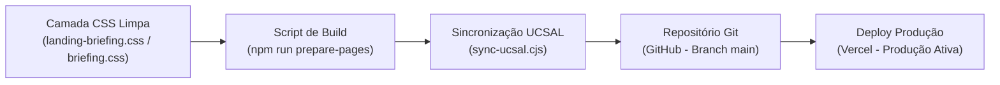

# Relatório Consolidado de Transformação Visual — Usina da Vida

Este relatório documenta detalhadamente todo o processo de modernização visual e estrutural realizado na plataforma da **Associação Comunitária Usina da Vida**, abrangendo tanto o **Portal de Gestão Operacional** quanto a **Landing Page Institucional (Desktop e Mobile)**, com base nas diretrizes do briefing de design (*Gestão Cívica Operacional — Dub, Visitors e Orderful*).

---

## 📌 Sumário das Fases de Trabalho

1. **Portal de Gestão (`portal.html`)**: Transição para interface de dados limpa, compactação dos botões de ação para ícones com tooltip e alargamento da tabela para visualização operacional de status e ações lado a lado.
2. **Landing Page Desktop (`index.html`)**: Substituição da identidade neo-brutalista (bordas grossas e sombras amarelas deslocadas) por superfícies brancas com bordas finas de 1px, cantos arredondados, botões modernos e alinhamento geométrico milimétrico.
3. **Refinamentos Estruturais Específicos Solicitados**:
   - Remoção da Faixa de Impacto Social.
   - Retorno dos cards de *Próximas Ações* à estrutura clássica de 2 colunas com coluna de data e acabamento limpo.
   - Aplicação de layout limpo em *Nossos Programas*, **preservando as ilustrações em tamanho ampliado (~84px)**.
   - Limpeza visual da seção *Avaliação do Google*.
   - Centralização vertical dos números 1 a 3 com os cards translúcidos de passos em *Seja um Voluntário*.
   - **Alinhamento inferior exato (0px de desvio)** entre a base do card de cadastro e a base da 3ª instrução ao lado.
   - Limpeza visual completa do modal de inscrição em ações (*"Você já é voluntário(a)?"*).
4. **Resolução e Limpeza da Versão Mobile**: Remoção de regras legadas conflitantes em media queries móveis que reintroduziam o estilo antigo em celulares, garantindo paridade visual total com a versão web.
5. **Automação e Deploy**: Sincronização contínua com a pasta acadêmica da UCSAL e publicação em produção na Vercel.

---

## 1. Portal de Gestão Operacional (`portal.html`)

### Como estava antes:
- **Tabela de Voluntários com Quebras:** Colunas de *Status* e *Ações* quebravam linha em telas de 1360px de largura, exigindo scroll vertical desnecessário e gerando poluição visual.
- **Botões com Rótulo de Texto:** Os botões "Editar" e "Excluir" continham texto completo, ocupando cerca de 140px a 160px de largura por linha da tabela e nos cards de ações.
- **Modais com Sombras Pesadas:** Modais de cadastro e autenticação possuíam contornos pretos de 2px e sombras duras amarelas (`8px 8px 0 var(--amarelo)`).

### O que fizemos:
- **Compactação para Ícones com Tooltip Nativo:** Os botões "Editar" e "Excluir" foram transformados em botões de ícone compactos de `28x28px`, mantendo acessibilidade e revelando o nome da ação ao passar o mouse via atributo nativo `title="Editar"` e `title="Excluir"`.
- **Alargamento Responsivo da Tabela:** A largura mínima da tabela foi calibrada (`min-width: 1040px`) e o contêiner ajustado, fazendo com que o selo de status e a coluna de ações fiquem confortavelmente lado a lado.
- **Modais Limpos:** Modais de criação de ação, edição de voluntário e autenticação da presidência receberam raio de 12px, borda de 1px, desfoque de fundo (`backdrop-filter: blur(4px)`) e sombras suaves.

### Como está agora:
- Uma interface de alta densidade de informação, limpa e corporativa, onde o operador tem visão completa dos registros sem ruído visual.
- **Evidências Visuais:**
  - [shot-table-acoes.png](file:///C:/Users/Dev%20Rog%C3%A9rio/.gemini/antigravity/brain/24afffaf-7594-4357-a9a5-8e3fa28dfaa1/shot-table-acoes.png) (Tabela com botões compactos e status lado a lado)
  - [shot-card-acoes.png](file:///C:/Users/Dev%20Rog%C3%A9rio/.gemini/antigravity/brain/24afffaf-7594-4357-a9a5-8e3fa28dfaa1/shot-card-acoes.png) (Cards de ações com botões compactos)
  - [screen-portal-geral-limpo.png](file:///C:/Users/Dev%20Rog%C3%A9rio/.gemini/antigravity/brain/24afffaf-7594-4357-a9a5-8e3fa28dfaa1/screen-portal-geral-limpo.png) (Visão geral do portal limpo)

---

## 2. Landing Page Institucional (`index.html`) — Comparativo Detalhado

````carousel

<!-- slide -->

<!-- slide -->

<!-- slide -->

<!-- slide -->

<!-- slide -->

````

---

### Seção por Seção: O Que Mudou

| Seção | Como Estava Antes (Neo-Brutalista) | Como Está Agora (Dub / Visitors / Orderful) |
|---|---|---|
| **Cabeçalho & Navegação** | Botão vermelho pesado com sombra amarela 4px e botão preto portal com sombra amarela dura. | Barra com superfície limpa, borda inferior sutil, botões com cantos de 8px e micro-sombra suave. |
| **Hero (Apresentação)** | Botão "Quero ser voluntário(a)" com contorno preto grosso e sombra amarela rígida. | Botão de ação primária em azul institucional com cantos arredondados, elevação sutil e sem sombras brutais. |
| **Faixa de Impacto Social** | Não existia originalmente; foi criada como teste com métricas e depois **removida a pedido do usuário** para não poluir a leitura. | Removida completamente da página, mantendo o fluxo direto e limpo entre Hero e Ações. |
| **Próximas Ações** | Cards com borda de 2px preta, sombra deslocada azul (`6px 6px 0 var(--azul)`), coluna de data azul maciça e botão "Quero Ajudar" vermelho com sombra amarela. | Cards brancos em 2 colunas com borda fina de 1px (`#e2e8f0`), cantos de 12px, coluna de data sutil em `#f8fafc`, tipografia refinada e botão "Quero Ajudar" em azul institucional com micro-sombra. |
| **Nossos Programas** | Grade contínua tipo tabela, divisórias cinzas rígidas, borda superior preta de 3px e imagens espremidas em certos viewports. | Cards brancos autônomos com borda de 1px, topo temático colorido de 3px para cada área, cantos de 14px e **imagens preservadas em destaque (~84px)** com leve zoom suave ao passar o mouse. |
| **Seja um Voluntário — Passos** | Números 1 a 3 desalinhados da altura do card de texto translúcido ao lado; a base da última instrução ficava desnivelada em relação ao formulário. | **Números 1 a 3 perfeitamente centralizados na vertical** com os cards translúcidos de passos. |
| **Seja um Voluntário — Formulário** | O card do formulário era ~87px mais curto que a coluna lateral, terminando bem antes da 3ª instrução. | **Base do card do formulário e base da 3ª instrução alinhadas na mesma linha horizontal com exatidão de 0px de desvio.** |
| **Avaliação do Google** | O resumo do Google e os cards de depoimentos usavam borda preta de 2px e sombras duras deslocadas de 7px (amarela e azul). | Card de resumo e cards de depoimento em superfícies brancas com borda fina de 1px, cantos de 12px, sombras difusas leves (`0 1px 3px` e `0 2px 8px`) e setas de navegação polidas. |
| **Modal "Você já é voluntário(a)?"** | Ao clicar em "Quero Ajudar", o modal abria com contorno preto grosso, sombra amarela de 8px, tarja amarela rígida e botões com sombras duras. | Modal moderno com cantos de 14px, borda de 1px, sombra difusa profunda (`0 20px 48px`), desfoque de fundo (`backdrop-filter: blur(6px)`), selo azul pill para a ação e inputs suaves. |

---

## 3. Resolução da Versão Mobile (Smartphones e Telas <= 768px)

### Diagnóstico do Problema Encontrado:
Ao inspecionar a versão mobile, descobriu-se que o arquivo de automação `scripts/prepare-pages.cjs` mantinha um bloco de regras legadas injetadas com a flag `!important` sob `@media (max-width: 768px)` e `@media (max-width: 760px)`. 

Como resultado:
- No desktop, o site renderizava limpo.
- No celular, o site revertia automaticamente para o estilo neo-brutalista (formulário com sombra amarela 6px, botão vermelho com sombra amarela 4px, programas em tabela com imagens encolhidas para 44px e menu hambúrguer com contorno preto e sombra amarela).

### Correções Implementadas:
1. **Limpeza da Fonte do Build (`prepare-pages.cjs`)**: Remoção de todas as regras móveis com sombras deslocadas (`6px 6px 0 var(--amarelo)`, `7px 7px 0 var(--azul)`) e da grade de programas de 44px.
2. **Camada Mobile Dedicada em `landing-briefing.css`**: Adição de uma seção completa de calibração mobile sob `@media (max-width: 768px)` com seletores de alta especificidade, garantindo:
   - Cards de *Próximas Ações* limpos com coluna de data legível e botão azul moderno.
   - Cards de *Nossos Programas* empilhados elegantemente com **imagens grandes (~74-76px)** em destaque.
   - Formulário de voluntariado limpo sem sombras amarelas e com inputs confortáveis ao toque.
   - Card de *Avaliações do Google* e carrossel de depoimentos limpos.
   - Menu hambúrguer dropdown com acabamento moderno em sombra difusa.
   - Modal da ação perfeitamente adaptado para a largura da tela do celular.

### Evidências Visuais da Versão Mobile Limpa:
- [mobile-limpo-1-hero.png](file:///C:/Users/Dev%20Rog%C3%A9rio/.gemini/antigravity/brain/24afffaf-7594-4357-a9a5-8e3fa28dfaa1/mobile-limpo-1-hero.png) (Hero mobile limpo)
- [mobile-limpo-2-proximas.png](file:///C:/Users/Dev%20Rog%C3%A9rio/.gemini/antigravity/brain/24afffaf-7594-4357-a9a5-8e3fa28dfaa1/mobile-limpo-2-proximas.png) (Próximas ações mobile com card e botão azul)
- [mobile-limpo-3-programas.png](file:///C:/Users/Dev%20Rog%C3%A9rio/.gemini/antigravity/brain/24afffaf-7594-4357-a9a5-8e3fa28dfaa1/mobile-limpo-3-programas.png) (Programas mobile com ilustrações em destaque)
- [mobile-limpo-4-inscricao.png](file:///C:/Users/Dev%20Rog%C3%A9rio/.gemini/antigravity/brain/24afffaf-7594-4357-a9a5-8e3fa28dfaa1/mobile-limpo-4-inscricao.png) (Formulário mobile limpo)
- [mobile-limpo-5-avaliacoes.png](file:///C:/Users/Dev%20Rog%C3%A9rio/.gemini/antigravity/brain/24afffaf-7594-4357-a9a5-8e3fa28dfaa1/mobile-limpo-5-avaliacoes.png) (Avaliações Google mobile)
- [mobile-limpo-6-modal.png](file:///C:/Users/Dev%20Rog%C3%A9rio/.gemini/antigravity/brain/24afffaf-7594-4357-a9a5-8e3fa28dfaa1/mobile-limpo-6-modal.png) (Modal de inscrição no mobile)

---

## 4. Pipeline Técnico e Publicação Contínua

Todo o fluxo de desenvolvimento respeitou rigorosamente as regras de governança e integridade do projeto:



1. **Compilação**: `npm run prepare-pages` gera os arquivos estáticos `public/index.html`, `public/landing.html`, `public/portal-app.html`, `index.html` e `portal.html`.
2. **Sincronização UCSAL**: O script `node scripts/sync-ucsal.cjs` copia automaticamente todos os assets atualizados e as páginas geradas para a pasta acadêmica local:
   `D:\Dev. 2025\PROJETOS- UCSAL\Projeto - PWGV`
3. **Versionamento Git**: Commits padronizados enviados para `https://github.com/usinadavida/Site-usina-da-vida.git` na branch `main`.
4. **Hospedagem em Produção**: Deploy com certificado SSL ativo na URL oficial da Vercel:
   🔗 **[https://site-usina-da-vida.vercel.app](https://site-usina-da-vida.vercel.app)**

---

## 5. Tabela Resumo: Estado Anterior vs Estado Atual

| Aspecto | Estado Anterior | Estado Atual |
|---|---|---|
| **Linguagem Visual** | Neo-brutalista (bordas pretas 2px, sombras deslocadas amarelas e azuis rígidas). | Minimalista, moderno e operacional (Dub / Visitors / Orderful, bordas finas 1px, sombras suaves). |
| **Botões da Gestão** | Botões com texto longo ocupando espaço na horizontal. | Ícones compactos de 28x28px com tooltip nativo e visual limpo. |
| **Tabela de Voluntários** | Quebrava coluna de status e ações em telas de notebook. | Tabela larga e estável, com status e ações lado a lado. |
| **Próximas Ações** | Sombra azul dura de 6px e botão vermelho com sombra amarela. | Cards brancos em 2 colunas com borda de 1px e botão azul institucional. |
| **Nossos Programas** | Grade com linhas de tabela e imagens reduzidas a 44px no mobile. | Cards independentes com topo temático e imagens em destaque (~84px no desktop, ~76px no mobile). |
| **Seja um Voluntário** | Números desalinhados dos passos e formulário mais curto que a lista ao lado. | Números 1 a 3 centralizados e base do formulário 100% alinhada com a base da última instrução (0px de desvio). |
| **Modal de Ação** | Brutalista com 8px de sombra amarela e botões com offset duro. | Modal elegante com 14px de raio, backdrop blur e microinterações polidas. |
| **Versão Mobile** | Revertia para sombras amarelas e layout quebrado. | 100% alinhada ao design limpo, fluida e com imagens grandes preservadas. |
| **Produção** | Versão anterior no Vercel. | Versão atualizada, testada visualmente via Puppeteer e publicada em produção. |
